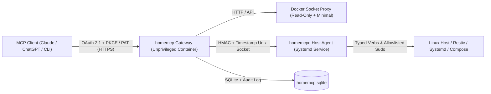

# homemcp

A **security-first, authenticated MCP (Model Context Protocol) server** for inspecting and safely managing a Linux home server from Claude, ChatGPT, Gemini CLI, or custom agents.

Designed from the ground up around **least privilege, typed host verbs, plan-confirm mutations, WebAuthn step-up authentication, and centralized secret redaction** — never raw shell execution over MCP.

---

## Architecture



| Layer                        | Security Boundary                                                                                                                                                                         |
| ---------------------------- | ----------------------------------------------------------------------------------------------------------------------------------------------------------------------------------------- |
| **Gateway Container**        | Non-root uid `1000:1000`, `read_only` rootfs, `cap_drop: ALL`, `no-new-privileges`, `homemcp_internal` bridge                                                                             |
| **Host Agent (`homemcpd`)**  | Runs outside container over a `0660` Unix socket signed with HMAC-SHA256 + nonce replay protection (`30s` window); executes only typed Zod-validated verbs with `execa({ shell: false })` |
| **Access Tiers (`T0`–`T3`)** | Read-only (`T0`), safe async jobs (`T1`), plan-then-confirm mutations (`T2`), and critical actions requiring a **fresh WebAuthn passkey** within 5 minutes (`T3`)                         |
| **Redaction & Trust**        | Single centralized `Redactor` scans all outputs, logs, audit records, and errors; external logs/metadata are tagged as untrusted data                                                     |

---

## Capabilities Overview

**141 tools across 15 toolsets**, **9 MCP resources**, and **8 workflow prompts** ([full generated reference](docs/tools.md) · [detailed feature catalog](docs/features.md)):

| Toolset       | Tools | Tiers      | Summary                                                                                                                                                              |
| ------------- | ----- | ---------- | -------------------------------------------------------------------------------------------------------------------------------------------------------------------- |
| `core`        | 6     | T0, T1     | Unified server overview, capabilities, async job status/cancel, audit logs                                                                                           |
| `system`      | 13    | T0, T2, T3 | CPU/RAM/thermal/battery health, sysstat trends, SMART disks, journald logs, security audit, systemd control, passkey-gated reboot                                    |
| `docker`      | 12    | T0, T2     | Container inspection/logs/stats, update checks, **auto-rollback digest updates**, prune plans                                                                        |
| `stacks`      | 11    | T0–T3      | Scan & validate Compose YAML against security policy, deploy curated templates, soft-trash removal                                                                   |
| `network`     | 14    | T0, T2, T3 | NPM proxy hosts, Cloudflare Tunnel ingress, DNS CNAMEs, exposure drift audit, reversible `expose_plan`/`expose_apply` & `unexpose_plan`/`unexpose_apply` sagas       |
| `backup`      | 6     | T0, T1, T3 | Restic S3/R2 freshness vs RPO, snapshot listing, manual runs, `restic check`, T3 staging-only restores                                                               |
| `vaultwarden` | 8     | T0–T3      | Health & lockdown audit + **dedicated Vaultwarden backup status, snapshots, run, integrity test, prune plan/apply, & T3 staging restore**                            |
| `apps`        | 1     | T0         | Configurable HTTP/HTTPS health probes across self-hosted apps                                                                                                        |
| `music`       | 14    | T0, T1, T2 | Navidrome/Subsonic library search, stats, rescan, fuzzy track matcher, playlist CRUD                                                                                 |
| `naviload`    | 10    | T0, T1     | Search and download tracks/albums/batches via NaviLoad and sync Navidrome                                                                                            |
| `media`       | 17    | T0, T1, T2 | Jellyfin libraries, sessions, search, problem finder, **Identify search/apply**, item inspect/metadata edit, single-item refresh, and qBittorrent-safe media renames |
| `downloads`   | 7     | T0, T1, T2 | Jackett torrent search/ranking, qBittorrent search/sort/inspect, categories, magnet/URL/result enqueue, pause/resume/recheck, plan-first removal                     |
| `alerts`      | 6     | T0, T1, T2 | Built-in metric/health rule watcher, ack/snooze, threshold tuning, `ntfy` + offline SQLite queue                                                                     |
| `files`       | 10    | T0, T1, T2 | Root-allowlisted file browse/read/write/move, `.env`/key denylist, soft-delete `.trash` (no `rm -rf`)                                                                |
| `auth`        | 6     | T0, T2, T3 | OAuth client listing/revocation and **passkey-revealed Personal Access Tokens (PATs)**                                                                               |

---

## Encrypted Backups & Vaultwarden Backup Management

Backups use **Restic** (client-side AES-256 encryption) stored in an S3-compatible bucket (such as Cloudflare R2), keeping all encryption keys and bucket secrets isolated in `0600 root:root` files outside the MCP gateway:

- **7 targeted backup sets** (`vaultwarden`, `configs`, `npm`, `navidrome`, `system`, `jellyfin`, `userdata`) archive consistent SQLite `.backup` copies and critical configuration while excluding huge regenerable media/cache directories.
- **Dedicated Vaultwarden backup management (`vaultwarden_backup_*`)**: inspect RPO freshness (`vaultwarden_backup_status`), browse snapshots (`vaultwarden_backup_snapshots`), trigger backups (`vaultwarden_backup_run`), run automated SQLite `PRAGMA integrity_check` + cipher count parity tests (`vaultwarden_backup_test`), plan & apply retention pruning (`vaultwarden_backup_prune_plan` / `vaultwarden_backup_prune_apply`), and stage manual recoveries safely without touching live data (`vaultwarden_backup_restore_staging`).

Read [docs/backups.md](docs/backups.md) and [docs/runbooks/restore-vaultwarden.md](docs/runbooks/restore-vaultwarden.md) for details.

---

## Quick Start (60 Seconds in Mock Mode)

Run everything locally against realistic stateful fixtures without touching any server:

```bash
pnpm install
pnpm build

# Verify unit/integration tests, deterministic evals, and secret scanner
pnpm test
pnpm eval
pnpm check:secrets

# Start gateway in mock stdio mode (for Claude Desktop / MCP Inspector)
node packages/gateway/dist/cli.js serve --transport stdio --mock
```

Or run over local HTTP with `/mcp` or focused toolsets (e.g. `/mcp/vaultwarden,backup`):

```bash
node packages/gateway/dist/cli.js serve --transport http --mock
```

---

## Production Deployment Summary

1. **Host Agent (`homemcpd`):** Build the agent release (`deploy/agent/build-release.sh`) and install step-by-step scripts under `deploy/agent/` (`install-p1.sh` read-only baseline -> `install-p4.sh` backup -> `install-p5.sh` docker/systemd -> `install-p6.sh` stacks/files).
2. **Gateway Container (`deploy/gateway/`):** Copy `examples/homemcp.config.example.yaml` and `deploy/gateway/.env.example`, set `HOMEMCP_SECRET_KEY` and `HOMEMCPD_HMAC_SECRET`, and launch via `deploy/gateway/deploy.sh`.
3. **Bootstrap Owner Identity:** Run `docker exec -it homemcp node /app/dist/cli.js auth bootstrap --config /config/homemcp.config.yaml` to enroll a WebAuthn passkey, TOTP backup, and offline recovery codes.

Full step-by-step instructions are in [docs/deployment.md](docs/deployment.md), [docs/auth.md](docs/auth.md), and [docs/clients.md](docs/clients.md).

---

## Repository Structure

| Path                                                   | Description                                                                                                                                                            |
| ------------------------------------------------------ | ---------------------------------------------------------------------------------------------------------------------------------------------------------------------- |
| [`packages/core`](packages/core/README.md)             | Shared types, error model (`HomemcpError`), tier/scope rules, centralized redactor, YAML config loader, Compose policy validator, path confinement                     |
| [`packages/connectors`](packages/connectors/README.md) | Typed HTTP/API clients for Docker, NPM, Cloudflare, Subsonic/Navidrome, NaviLoad, Jellyfin, qBittorrent, Jackett, Vaultwarden, `ntfy`, Healthchecks.io, and `homemcpd` |
| [`packages/agent`](packages/agent/README.md)           | Privileged Linux host daemon (`homemcpd`): HMAC socket server, binary allowlist runner, and strict Zod-validated host verbs                                            |
| [`packages/gateway`](packages/gateway/README.md)       | MCP server (`stdio` / HTTP), OAuth 2.1 + WebAuthn + PAT auth server, SQLite job/plan/alert stores, background watcher, and all 15 tool modules                         |
| [`packages/mock`](packages/mock/README.md)             | Stateful in-memory fixtures, `MockExecutor`, and mock HTTP connectors for zero-risk local testing and CI evals                                                         |
| [`templates`](templates/README.md)                     | Curated Compose service templates (`actual-budget`, `homepage`, `it-tools`, `ntfy`, `searxng`, `shlink`, `uptime-kuma`)                                                |
| [`deploy`](deploy/README.md)                           | Systemd units, sudoers rules, staged host installer scripts, and hardened gateway Dockerfile/Compose                                                                   |
| [`evals`](evals/README.md)                             | Deterministic 40-task functional, security, safety, and prompt-injection evaluation suite                                                                              |
| [`docs`](docs/architecture.md)                         | Architecture, threat model, auth, backup guide, feature catalog, client setup, runbooks, and auto-generated tool docs                                                  |

---

## Documentation Index

- [Architecture Overview](docs/architecture.md) · [Threat Model](docs/threat-model.md) · [Security Policy](SECURITY.md)
- [Authentication (OAuth 2.1, Passkeys, PATs)](docs/auth.md) · [Connecting MCP Clients](docs/clients.md)
- [Encrypted Backups & Vaultwarden Backups](docs/backups.md) · [Full Feature Catalog](docs/features.md) · [Auto-Generated Tool Reference](docs/tools.md)
- [Production Deployment](docs/deployment.md) · [Evaluations](docs/evals.md) · [Contributing](CONTRIBUTING.md)
- **Operational Runbooks:** [Restore Vaultwarden](docs/runbooks/restore-vaultwarden.md) · [Rotate Tunnel Token](docs/runbooks/rotate-tunnel-token.md) · [Add Service](docs/runbooks/add-service.md) · [Disk Full](docs/runbooks/disk-full.md) · [Break-Glass Recovery](docs/runbooks/break-glass.md)

## License

[Apache-2.0](LICENSE)
