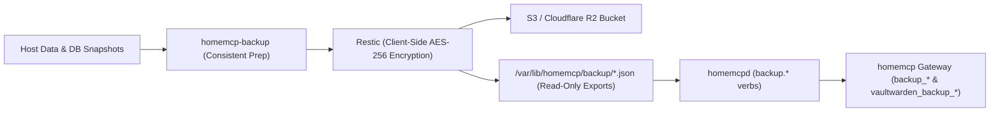

# Encrypted Backups & Vaultwarden Backup Management

`homemcp` pairs a dedicated root backup runner (`homemcp-backup`) using **Restic** over S3-compatible object storage (such as Cloudflare R2) with tiered MCP tools for monitoring freshness, triggering backups, verifying SQLite integrity, pruning expired snapshots, and restoring snapshots into an isolated staging directory.

---

## Architecture & Storage Model

- **Where backups live:** All backup data is deduplicated, compressed, and encrypted client-side by Restic before leaving the host, then uploaded to an S3-compatible object storage bucket (e.g. Cloudflare R2). Even if bucket credentials are compromised, ciphertext cannot be decrypted without the Restic repository password.
- **Credential isolation:** S3 credentials (`restic.env`) and the Restic encryption password (`restic.pass`) live strictly in `0600 root:root` files under `/etc/homemcp/backup/`. Neither the unprivileged gateway container nor the `homemcpd` MCP server ever receives backup keys or reads those files.
- **Status metadata export:** After each run or maintenance pass, `homemcp-backup` writes sanitized metadata (`status.json`, `snapshots.json`, `stats.json`) into `/var/lib/homemcp/backup/`. The `backup.read_status` verb reads only those exports.
- **Monitoring & storage budget:** Each run pings Healthchecks.io (`start` / `ok` / `fail`), alerts via `ntfy` on failures, and checks total repository size against `budgetBytes` (default `7,000,000,000` bytes / 7 GB).

---

## Backup Sets, Schedules, and Retention

Backups are split into **7 targeted sets** so critical databases run frequently while multi-terabyte re-downloadable media libraries are excluded.

| Set           | What Is Backed Up                                                                                                                     | Typical Frequency | RPO Target | Retention Policy                                                  | Key Exclusions                                                         |
| ------------- | ------------------------------------------------------------------------------------------------------------------------------------- | ----------------- | ---------- | ----------------------------------------------------------------- | ---------------------------------------------------------------------- |
| `vaultwarden` | Vaultwarden consistent DB (`db.sqlite3`), `rsa_key*`, `config.json`, `attachments/`, `sends/`                                         | Every 6 hours     | `24h`      | `--keep-last 4 --keep-daily 14 --keep-weekly 8 --keep-monthly 12` | Lock/WAL scratch files, icon cache                                     |
| `configs`     | Compose definitions (`/home/homelab/docker-containers`), projects, downloader/client configs, SSH/shell config, `/opt/homemcp` config | Daily             | `48h`      | `--keep-daily 7 --keep-weekly 4 --keep-monthly 6`                 | `node_modules`, `.venv`, media blobs, gateway runtime DB/node dist     |
| `npm`         | Consistent SQLite snapshot of Nginx Proxy Manager DB, proxy config, Let's Encrypt certs, compose file                                 | Daily             | `48h`      | `--keep-daily 7 --keep-weekly 4 --keep-monthly 6`                 | Access/error logs                                                      |
| `navidrome`   | Consistent SQLite `.backup` of `navidrome.db` and `naviload` state DB + config                                                        | Daily             | `48h`      | `--keep-daily 7 --keep-weekly 4 --keep-monthly 6`                 | Transcode cache, `.m4a`/audio media files, downloader staging/previews |
| `system`      | `/etc`, `/var/spool/cron`, `/root`, Portainer volume data                                                                             | Daily             | `48h`      | `--keep-daily 7 --keep-weekly 4 --keep-monthly 6`                 | `/etc/homemcp/backup` secrets, `/root/.cache`                          |
| `jellyfin`    | Consistent `jellyfin.db` SQLite backup + XML/server config                                                                            | Weekly            | `8d`       | `--keep-weekly 4 --keep-monthly 3`                                | Bulk movies/series, generated metadata/trickplay/transcode caches      |
| `userdata`    | FileBrowser DB, Immich/Nextcloud/Samba configs, game server saves/configs                                                             | Weekly            | `8d`       | `--keep-weekly 4 --keep-monthly 3`                                | Generated thumbnails, encoded videos, temp caches                      |

> [!IMPORTANT]
> **Why SQLite databases are staged with `.backup` or native backup commands:** Copying an active SQLite file directly can produce a corrupt snapshot mid-transaction. `homemcp-backup` creates consistent point-in-time SQLite copies in staging and runs `PRAGMA integrity_check` before archiving.

---

## Dedicated Vaultwarden Backup Management (MCP Tools)

Vaultwarden has both general backup access (`backup_*`) and **7 dedicated Vaultwarden backup tools** in the `vaultwarden` toolset, so an AI client with `?toolsets=vaultwarden` or `homemcp:read`/`operate`/`admin` can manage Vaultwarden backups end-to-end without touching other sets or live secrets.

| Tool                                 | Tier | Scope             | Purpose                                                                                                                                                                    |
| ------------------------------------ | ---- | ----------------- | -------------------------------------------------------------------------------------------------------------------------------------------------------------------------- |
| `vaultwarden_health`                 | `T0` | `homemcp:read`    | Checks `/alive`, upstream version delta, signup/admin lockdown flags, `DOMAIN`, and backup freshness (never reads vault contents)                                          |
| `vaultwarden_backup_status`          | `T0` | `homemcp:read`    | Reports Vaultwarden RPO freshness, snapshot count, latest restore-test cipher/user verification, schedule (`every 6h`), retention policy, and repo budget                  |
| `vaultwarden_backup_snapshots`       | `T0` | `homemcp:read`    | Lists encrypted Vaultwarden Restic snapshots (`set=vaultwarden`, newest first) with IDs and timestamps                                                                     |
| `vaultwarden_backup_run`             | `T1` | `homemcp:operate` | Runs an immediate consistent Vaultwarden backup (`db.sqlite3`, RSA keys, config, attachments, sends) as a tracked background job                                           |
| `vaultwarden_backup_test`            | `T1` | `homemcp:operate` | Restores a chosen snapshot (`latest` or hex ID) into a temporary directory, verifies `PRAGMA integrity_check == ok` and cipher/user counts against live DB, then cleans up |
| `vaultwarden_backup_restore_staging` | `T3` | `homemcp:admin`   | Plan-first + **fresh passkey (`auth_time <= 5m`)** restore into `/var/lib/homemcp/backup/staging-restore/<subdir>` — **never overwrites live Vaultwarden data**            |
| `vaultwarden_backup_prune_plan`      | `T0` | `homemcp:read`    | Runs `restic forget --dry-run` on `set=vaultwarden` against the retention policy and returns a `plan_id` + confirmation link                                               |
| `vaultwarden_backup_prune_apply`     | `T2` | `homemcp:admin`   | Executes a confirmed Vaultwarden retention prune plan (`restic forget --prune` scoped strictly to `--tag set=vaultwarden`)                                                 |

### Typical Vaultwarden Recovery & Verification Flows

**Routine verification drill (non-destructive, T1):**

1. Call `vaultwarden_backup_status()` or `vaultwarden_backup_snapshots()` to inspect recent snapshots.
2. Call `vaultwarden_backup_test({ snapshot_id: "latest" })` — restores into a clean temp folder, checks SQLite integrity and cipher count parity, and removes the temp directory automatically.

**Safe restore to staging for manual cutover (T3):**

1. Call `vaultwarden_backup_restore_staging({ snapshot_id: "<hex-id>", staging_subdir: "vw-recovery" })` without `plan_id`.
2. Open the returned `/confirm/:id` link and approve with a **fresh WebAuthn passkey** ceremony.
3. Re-invoke `vaultwarden_backup_restore_staging({ snapshot_id: "<hex-id>", staging_subdir: "vw-recovery", plan_id: "..." })`.
4. Complete the final cutover manually on the host per [docs/runbooks/restore-vaultwarden.md](./runbooks/restore-vaultwarden.md).

---

## General Backup Management Tools (`backup` Toolset)

| Tool                  | Tier | Purpose                                                                                                                              |
| --------------------- | ---- | ------------------------------------------------------------------------------------------------------------------------------------ |
| `backup_status`       | `T0` | Per-set freshness vs configured RPO, restore-test telemetry, and R2 repo usage vs budget                                             |
| `backup_snapshots`    | `T0` | Lists Restic snapshots optionally filtered by `set` (`vaultwarden`, `configs`, `npm`, `navidrome`, `system`, `jellyfin`, `userdata`) |
| `backup_run`          | `T1` | Triggers an on-demand Restic backup for one set or `all` as a tracked job                                                            |
| `backup_verify`       | `T1` | Runs `restic check` (repository metadata/pack consistency verification)                                                              |
| `backup_restore_test` | `T1` | Runs the non-destructive temporary Vaultwarden restore & SQLite integrity check                                                      |
| `backup_restore`      | `T3` | Plan-first + fresh passkey restore of any set into `/var/lib/homemcp/backup/staging-restore/<subdir>`                                |

---

## Scheduled Maintenance & Disaster Recovery

- **Weekly maintenance:** Prunes expired snapshots per each set's `--keep-*` policy, runs `restic check`, updates `/var/lib/homemcp/backup/{snapshots,stats}.json`, and sends an alert if usage exceeds `budgetBytes`.
- **Monthly deep verification:** Runs `restic check --read-data-subset=10%` and executes an automated Vaultwarden restore test verifying SQLite integrity and cipher counts against the live database.
- **Total host loss ("Cold Metal Recovery"):** Store the Restic repository password, S3/R2 endpoint + keys, Cloudflare emergency recovery details, and break-glass owner recovery material offline in a physical **Paper Recovery Kit**. Even if the host disk fails completely, another Linux machine with Restic and those printed keys can restore all 7 sets directly from object storage.
